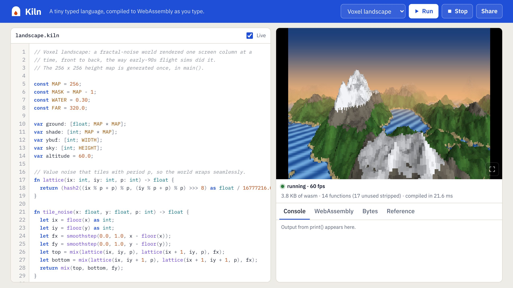
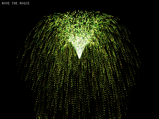
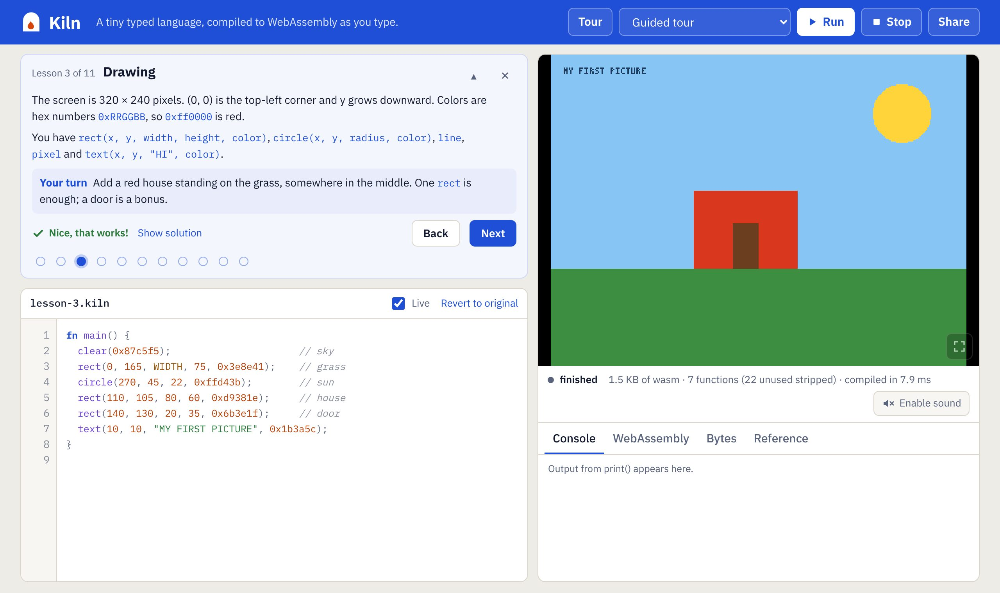

# Kiln

**A tiny statically typed language that compiles straight to WebAssembly, with a live-coding pixel playground.**

Kiln's compiler is about 4,500 lines of dependency-free JavaScript. It lexes, parses, type-checks and
then writes the WebAssembly binary *byte by byte*: no LLVM, no Binaryen, no `wat2wasm`. It is fast
enough to recompile on every keystroke, so the playground feels like a fantasy console: type
code on the left and watch it run at native speed on a 320×240 screen on the right, with sound.



<table>
<tr>
<td><br><sub><b>landscape</b>: voxel-space terrain flyover</sub></td>
<td><br><sub><b>raymarch</b>: signed distance fields, soft shadows</sub></td>
</tr>
<tr>
<td><br><sub><b>mandelbrot</b>: endless deep zoom, two pixels at a time in double precision</sub></td>
<td><br><sub><b>julia</b>: morphing Julia sets, four pixels at a time with SIMD</sub></td>
</tr>
<tr>
<td><br><sub><b>fire</b>: the word KILN, burning</sub></td>
<td><br><sub><b>plasma</b>: the demoscene classic</sub></td>
</tr>
<tr>
<td><br><sub><b>particles</b>: 4,000 particles with additive light</sub></td>
<td><br><sub><b>life</b>: Conway's Life with glowing trails; draw with the mouse</sub></td>
</tr>
<tr>
<td><br><sub><b>dodge</b>: a small arcade game with sound effects</sub></td>
<td><br><sub><b>sequencer</b>: click to compose; a 16-step drum and melody loop</sub></td>
</tr>
<tr>
<td><br><sub><b>hello</b>: a guided first program</sub></td>
<td></td>
</tr>
</table>

Every image above was rendered headlessly by the Kiln CLI (`kiln render`), from the programs in [`examples/`](examples).

## Try it

```sh
npm run serve          # builds the playground and serves it at http://localhost:8000
```

Or run `npm run build` and open `dist/index.html` directly. It's a single self-contained file that works
offline, from `file://`. There's nothing to install: the project has zero dependencies.

### The guided tour

New to Kiln? Press **Tour** in the playground (or open `#tour`). Eleven short lessons cover printing, types,
drawing, loops, animation, input, functions, arrays, structs, sound, and finally the WebAssembly your code turns into.
Each lesson explains one idea, gives you a starter program and sets one small task.



You don't press a "check" button: the playground watches what your program *does* (what it prints, the pixels on
screen, the sounds it makes, whether it reacts while you hold the mouse) and the lesson turns green as soon as the task
is met. Because the checks look at behavior rather than your exact code, any working answer counts. You can skip
around, peek at a solution and flip back to your own attempt. Progress and edits are saved in your browser.

The lessons live in [`web/lessons.js`](web/lessons.js). Their checks are plain functions of a snapshot of the running
program, so the test suite takes the tour headlessly: every starter must run *without* passing, and every solution
(plus some alternative answers) must pass.

The command-line tool runs on Node 20+:

```sh
node bin/kiln.js run examples/hello.kiln          # compile and run main()
node bin/kiln.js wat examples/plasma.kiln         # print the generated WebAssembly text
node bin/kiln.js build examples/fire.kiln         # write fire.wasm
node bin/kiln.js render examples/raymarch.kiln -t 3 -o shot.png   # headless screenshot
node bin/kiln.js audio examples/sequencer.kiln -t 8 -o loop.wav    # headless audio recording
```

## A taste

```rust
// Every pixel adds up a few sine waves; the sum picks a color.
fn frame(t: float) {
  for y in 0..HEIGHT {
    for x in 0..WIDTH {
      let u = x as float / 38.0;
      let v = y as float / 38.0;
      let s = sin(u + t) + sin((v + t) * 0.7) + sin((u + v + t * 0.6) * 0.8);
      pixel(x, y, hsv(s * 0.15 + t * 0.05, 0.8, 1.0));
    }
  }
}
```

`main()` runs once; `frame(t)` runs every animation frame. Programs draw into a 320×240 framebuffer
(colors are `0xRRGGBB`), read the mouse and keyboard, and `print()` to a console.

## The language

```rust
const N = 64;                     // compile-time constant (folded away)
var grid: [int; N * N];           // arrays are global, zeroed, bounds-checked
let palette = [0x000000, 0xff8800, 0xffffff];
var score = 0;                    // mutable global

fn clamp01(x: float) -> float {
  return x < 0.0 ? 0.0 : (x > 1.0 ? 1.0 : x);
}

fn main() {
  let name = "kiln";              // immutable, type inferred (str)
  var total = 0;                  // mutable
  for i in 0..len(name) { total += name[i]; }    // strings index to bytes
  for i in 1..=10 { if i % 2 == 0 { continue; } total += i; }
  while total > 100 { total /= 2; }
  print("total:", total, "half:", total as float / 2.0);
}
```

- **Types:** `int` (i32), `float` (f64), `bool`, `str`, structs, and fixed-size global arrays of any of those except `str`.
- **No silent conversions.** `int + float` is an error that suggests `as float`. One concession for
  comfort: integer *literals* (and untyped integer constants) adapt to float context, so `x * 2` works when `x` is a float.
- **`let` is immutable, `var` is mutable.** Assigning to a `let` is a compile error with a fix-it hint.
- **Control flow:** `if`/`else if`/`else`, `while`, `for i in a..b` and `a..=b`, `break`, `continue`, `return`, and `cond ? a : b`.
- **Operators:** the usual arithmetic, comparison and logical operators (short-circuiting), plus `& | ^ ~ << >> >>>` and
  compound assignment. Bitwise operators bind tighter than comparisons, so `x & 1 == 1` means what it looks like.
- **Built-ins** compile to single wasm instructions where possible (`sqrt`, `floor`, `min`, `abs`, `select`, ...);
  transcendental functions (`sin`, `pow`, ...) are imported from the host.
- **The standard prelude is written in Kiln** ([`src/prelude.js`](src/prelude.js)): `pixel`, `rect`, `circle`, Bresenham
  `line`, `hsv`, `blend`, a 3×5 bitmap font for `text` and `number`, integer `hash`, value `noise` and `fbm`.
  It's compiled together with your program, and whatever you don't use is stripped.

### Structs

```rust
struct Vec2 { x: float, y: float }
struct Ball { pos: Vec2, vel: Vec2, color: int }

const GRAVITY = Vec2(0.0, 260.0);   // constructed like a call, folded at compile time
var balls: [Ball; 100];             // arrays of structs

fn length(v: Vec2) -> float { return sqrt(v.x * v.x + v.y * v.y); }

fn step(dt: float) {
  for i in 0..len(balls) {
    var b = balls[i];               // structs are values: this is a copy
    b.vel += GRAVITY * dt;          // component-wise math
    b.pos += b.vel * dt;
    if b.pos.y > 239.0 { b.vel.y *= -0.8; }
    balls[i] = b;                   // write it back
  }
}
```

- Structs are **values**, like numbers: assigning or passing one copies it. There are no pointers and no heap.
- Structs whose fields are all floats (or all ints) get **component-wise** `+ - * / %`, with each other or with a
  single number on either side, GLSL-style. Any struct supports `==` and `!=`.
- `print(v)` shows a struct the way you'd construct it: `Ball(Vec2(1.0, 2.0), Vec2(0.0, 0.0), 16746496)`.

Under the hood, a struct is **flattened into its scalar fields**. A `Vec2` local is two wasm locals, a `Vec2` parameter
is two wasm parameters, and a function returning one uses wasm's multi-value returns. So vector math costs exactly what
the scalar version would. This function:

```rust
export fn add(a: Vec2, b: Vec2) -> Vec2 { return a + b; }
```

compiles to two additions, with no memory traffic and no temporaries:

```wasm
(func $add (export "add") (param $a.x f64) (param $a.y f64) (param $b.x f64) (param $b.y f64) (result f64 f64)
  local.get $a.x
  local.get $b.x
  f64.add
  local.get $a.y
  local.get $b.y
  f64.add
  return
)
```

Arrays of structs are laid out in linear memory with natural alignment, and `balls[i].vel.y` compiles to one bounds
check plus a single `f64.load` at a constant offset.

### Methods

```rust
impl Vec2 {
  fn zero() -> Vec2 { return Vec2(0.0, 0.0); }        // static: Vec2.zero()
  fn dot(self, o: Vec2) -> float { return self.x * o.x + self.y * o.y; }
  fn length(self) -> float { return sqrt(self.dot(self)); }
  fn normalize(self) -> Vec2 { return self / self.length(); }
}

impl Ball {
  fn update(var self, dt: float) {                    // changes the ball it's called on
    self.vel += GRAVITY * dt;
    self.pos += self.vel * dt;
  }
}

balls[i].update(dt);
let speed = balls[i].vel.length();
```

- Methods live in `impl` blocks and are namespaced per struct, so a `Vec2` and a `Vec3` can each have `length()`.
- `self` is a copy, so calling `v.length()` can never change `v`. Writing to a plain `self` is a compile error that
  suggests `var self`.
- A **`var self`** method changes the value it's called on. It works on variables, array elements and fields of
  either; calling one on a temporary or an immutable value is an error. A method without `self` is called on the type:
  `Vec2.zero()`.

A method is an ordinary function named `Type.method` with `self`'s fields as its first parameters. A `var self` method is
*copy-in/copy-out*: it returns the updated receiver as extra results (wasm multi-value again), and the caller stores them
back where the receiver came from:

```wasm
(func $Ball.update (param $self.pos.x f64) (param $self.pos.y f64) (param $self.vel.x f64) (param $self.vel.y f64)
                   (param $self.color i32) (param $dt f64) (result f64 f64 f64 f64 i32)
```

The ray marcher's vector math and the particle fountain's update loop use methods; both render byte-for-byte the same
images as before, at the same speed.

### Operator methods

```rust
struct Complex { re: float, im: float }

impl Complex {
  // (a + bi)(c + di) = (ac - bd) + (ad + bc)i
  fn *(self, o: Complex) -> Complex {
    return Complex(self.re * o.re - self.im * o.im, self.re * o.im + self.im * o.re);
  }
  fn abs2(self) -> float { return self.re * self.re + self.im * self.im; }
}

while i < max_iter && z.abs2() < 256.0 {
  z = z * z + c;        // your *, then the built-in component-wise +
  i += 1;
}
```

- Define `+ - * / % == != < <= > >=` inside an `impl`, and unary `-` as `fn -(self)`.
- Operators **overload by operand type**, and the struct can be on either side: `fn *(self, k: float)` handles `z * 2.0`
  and `fn *(k: float, z: Complex)` handles `2.0 * z`. An int literal is accepted where a float operand is expected.
- **Derived comparisons:** `!=` comes from `==`, and `>`, `<=`, `>=` from `<`. Operands are still evaluated left to
  right, and an operator you define yourself always wins over a derived one.
- Anything you don't define keeps the **built-in behavior** (component-wise math, structural `==`), so `Complex` above
  gets `+` and `-` for free. Compound assignment (`z *= w`) uses your operator too.
- The checker requires exactly one or two operands, a struct of the impl's type on one side, `bool` from comparisons,
  and no `var self`. Using an operator a struct has no built-in version of (like `<`, or `+` on a struct with a `str`
  field) gets a hint showing the method to write.

An operator is a method named `Type.op<symbol>`, so `z * w` is a call to `$Complex.op*` (overloads get a `_2`, `_3`
suffix). User operators run at run time, so they can't appear in a `const`.

To keep operators as cheap as the math they replace, codegen **inlines** small functions: any function, method or
operator whose body is a single `return <expr>;` of at most 48 nodes is expanded in place, up to 4 levels deep and at
most 1000 inlined nodes per function. Arguments are evaluated once, left to right, into locals (a variable argument is
used in place), and a function inlined at every call site is left out of the module. This function:

```rust
export fn step(z: Complex, c: Complex) -> Complex { return z * z + c; }
```

compiles to the complex multiplication pasted in place, then the component-wise `+`, with no call:

```wasm
(func $step (export "step") (param $z.re f64) (param $z.im f64) (param $c.re f64) (param $c.im f64) (result f64 f64)
  (local $t.4 f64) (local $t.5 f64)
  ;; inlined Complex.op*
  local.get $z.re
  local.get $z.re
  f64.mul
  local.get $z.im
  local.get $z.im
  f64.mul
  f64.sub
  local.get $z.re
  local.get $z.im
  f64.mul
  local.get $z.im
  local.get $z.re
  f64.mul
  f64.add
  local.set $t.5
  local.tee $t.4
  local.get $c.re
  f64.add
  local.get $t.5
  local.get $c.im
  f64.add
  return
)
```

Written this way with plain `float`s, the Mandelbrot example rendered exactly the same pixels as the hand-written
scalar loop it replaced, within about 8% of its speed. (It now uses SIMD; see below.) Inlining also makes the ray
marcher 19% faster. `compile(src, { inline: false })`
turns it off; the tests check that every example prints, draws and plays exactly the same either way.

### SIMD vectors

```rust
let v = f32x4(1.0, 2.0, 3.0, 4.0);   // four 32-bit floats in one 128-bit value
let w = v * 2.0 + v;                 // lane by lane; a scalar fills all four lanes
let m = w > 5.0;                     // a boolx4 mask: one bool per lane
let r = select(m, w, 0.0);           // f32x4(0.0, 6.0, 9.0, 12.0)
if any(m) { print(r.y); }            // lanes are .x .y .z .w
```

- **`f32x4`** holds four 32-bit floats and supports `+ - * / %` and comparisons. **`i32x4`** holds four ints and supports
  `+ - *`, comparisons, `& | ^ ~` and shifts by an int. It has no `/`, because WebAssembly SIMD has no integer
  division, and the checker says so.
- **`f64x2`** holds two 64-bit floats, with the same operations as `f32x4` but full double precision.
- **Comparisons give a mask:** `boolx4` for four-lane vectors, `boolx2` for `f64x2`. Combine masks with `& | ^ !`, test
  them with `any(m)`/`all(m)`, choose lane by lane with `select(m, a, b)`, and count with `m as i32x4` (or
  `m as f64x2`), which gives 1 or 0 per lane. Using a mask as an `if` condition is an error that points to
  `any`/`all`.
- **Lanes** are `.x .y .z .w` (`.x .y` for two-lane types), for reading and writing, wherever the vector lives. An
  `f32x4` lane reads as an ordinary (64-bit) `float`.
- **A scalar next to a vector** fills every lane. Int literals adapt to `f32x4` and `f64x2` like they do to `float`,
  and everything else needs an explicit `as`.
- **Lane-wise builtins:** `sqrt floor ceil trunc round abs min max clamp`. `as` converts between vector types with the
  same number of lanes: `f32x4`, `i32x4` and `boolx4`, or `f64x2` and `boolx2`.
- **Bit-casts:** `to_bits(v)` reads an `f32x4`'s IEEE 754 bit patterns as an `i32x4`, and `from_bits(i)` turns them
  back. A `v128` is just 128 bits, so both compile to no instructions at all.
- **Vectors are values:** locals, parameters, return values, struct fields, globals, array elements and constants (folded
  at compile time, with f32 rounding for `f32x4`). A struct whose fields are all `f32x4` (or all `f64x2`) gets
  component-wise math and operators, like any other struct.

Each vector is a single wasm `v128` value, so `a * b + c` on four pixels compiles to two instructions. The
[`julia`](examples/julia.kiln) example shades four pixels per loop iteration. Its `C4` struct holds four complex
numbers, so the inner loop still reads like the math:

```rust
for i in 0..MAX_ITER {
  let inside = z.abs2() < 256.0;      // which lanes haven't escaped
  if !any(inside) { break; }
  n += inside as i32x4;               // count only those
  let next = z * z + c;
  z = C4(select(inside, next.re, z.re), select(inside, next.im, z.im));
}
```

```wasm
;; inlined C4.abs2
local.get $z.re
local.get $z.re
f32x4.mul
local.get $z.im
local.get $z.im
f32x4.mul
f32x4.add
v128.const f32x4 256 256 256 256
f32x4.lt
local.tee $inside
v128.any_true
```

The coloring is four-wide too. Smooth coloring needs `log2(ln|z|)` for every pixel, and WebAssembly SIMD has no
logarithm, so the example builds one from the float format. `to_bits` reads the exponent straight out of bits 23–30,
and a short series handles the mantissa:

```rust
fn log2v(x: f32x4) -> f32x4 {
  let bits = to_bits(x);
  let e = ((bits >> 23) & 255) - 127;
  let m = from_bits((bits & 0x7fffff) | 0x3f800000);   // same mantissa, exponent 0
  let s = (m - 1.0) / (m + 1.0);                       // log2(m) = 2/ln(2) * atanh(s)
  let s2 = s * s;
  return e as f32x4 + s * (2.8853901 + s2 * (0.9617967 + s2 * (0.5770780 + s2 * 0.4121986)));
}
```

Its error is under 2e-5, far finer than one palette step; a test keeps it under 3e-5. Only the palette lookups
and the pixel writes are still one lane at a time.

Compared with the same program written with `float`s one pixel at a time (which calls JavaScript's `log` twice per
pixel), it renders the same image (no pixel differs by more than 8/255) and runs a whole frame **about 2.3× faster**
(2.15–2.5× across the animation, in Node 22). Before the coloring went four-wide, it was 1.5×. The iteration loop
alone is 1.7–2× faster. It doesn't reach 4×, because every iteration also pays for the mask, and a group of four
keeps going until its slowest pixel escapes.

**Two lanes in double precision.** The [`mandelbrot`](examples/mandelbrot.kiln) example zooms up to 640,000× into the set.
By the end, neighboring pixels are about 2e-8 apart, less than an f32 can resolve near the zoom's center (its
spacing there is 6e-8). So the example uses `f64x2`: a `C2` struct with the same `*` operator and the same masked
loop, two pixels at a time. The cost of the masks shows more with two lanes than with four. Measured across the zoom
against the scalar `float` version:

| version | speed | pixels |
|---|---|---|
| scalar `float`, one pixel at a time | 1× | the reference |
| `f64x2`, two at a time (the example) | **1.17×** (1.10–1.24×) | identical, in every frame |
| `f32x4`, four at a time | 1.70× | from 25 s of zoom on, 19–44% are off by more than 24/255 |

There is no scalar `f32` type: on current CPUs, scalar f32 and f64 add and multiply run at the same speed, so the gain
comes from the lanes. Lanes are always named, never indexed with a variable.

### Sound

```rust
beep(440.0, 0.2);                               // frequency in Hz, seconds
sound(WAVE_SQUARE, 988.0, 1976.0, 0.1, 0.3);    // wave, from Hz, to Hz, seconds, volume
sound(WAVE_NOISE, 2500.0, 70.0, 0.9, 1.0);      // noise sweeping down: an explosion
sound_at(t + 0.5, WAVE_TRIANGLE, note(60), note(60), 0.3, 0.5);   // middle C, half a second from now
```

Five waves (square, triangle, saw, sine and filtered noise), each with an exponential pitch slide and a short
attack-hold-fade envelope. That's enough for chiptune music and arcade effects. `note(n)` converts MIDI note
numbers to Hz.

Programs run in a Web Worker, which can't use Web Audio, so a sound call just records an *event* on the program's
clock (the same clock as `t` and `now()`). Events ride along with each frame's pixels, and the page schedules them on
the audio clock with a small fixed latency. Because events carry exact times, `sound_at` can schedule notes between
frames: the [sequencer](examples/sequencer.kiln) uses the classic look-ahead pattern, so its beat stays sample-steady
even when frames jitter.

Every event follows one small spec ([`src/sound.js`](src/sound.js)), implemented twice: with Web Audio nodes in the
playground, and by a software synth ([`src/synth.js`](src/synth.js)) that `kiln audio` uses to record WAV files. The
software synth is also what the tests listen to: they measure pitch, slides, timing and the envelope from the samples.

### Friendly errors

The checker reports every type error it finds, with a span, and offers suggestions where it can:

```
error: can't apply '+' to int and float
 --> demo.kiln:4:13
  |
4 |   let c = a + b;
  |             ^
  = help: Kiln never converts silently; write 'x as float' or 'x as int'
```

It also suggests close matches for misspelled names (`unknown function 'pixl'` gets "did you mean 'pixel'?"), catches
functions that don't return on every path, and rejects assignments to immutable values, among other things. Runtime
traps come back with line numbers too: `index 4 is out of bounds for 'grid', which has 4 elements (line 12)`.

## How it works

```
source ──lex──▶ tokens ──parse──▶ AST ──check──▶ typed AST ──codegen──▶ .wasm bytes + WAT listing
                                      (prelude AST joins here)    │
                                                                  └─ reachable functions only
```

| File | What it does |
|---|---|
| [`src/lexer.js`](src/lexer.js) | Tokens with spans; hex/binary/underscored literals, escapes, block comments |
| [`src/parser.js`](src/parser.js) | Recursive descent for statements, precedence climbing for expressions |
| [`src/checker.js`](src/checker.js) | Name resolution, type inference and checking, constant folding, definite-return analysis, call graph |
| [`src/types.js`](src/types.js) | Struct flattening and memory layout |
| [`src/codegen.js`](src/codegen.js) | Emits wasm instructions and a matching WAT listing side by side; strips dead code |
| [`src/wasm.js`](src/wasm.js) | LEB128, section encoding, the opcode table |
| [`src/prelude.js`](src/prelude.js) | The standard library, in Kiln |
| [`src/runtime.js`](src/runtime.js) | Host imports, readable trap messages, framebuffer to RGBA, sound events |
| [`src/sound.js`](src/sound.js), [`src/synth.js`](src/synth.js) | The sound spec, and an offline synth with a WAV encoder |
| [`web/`](web) | The playground: editor, worker runner with a watchdog, audio, inspector tabs, the guided tour |
| [`scripts/build.js`](scripts/build.js) | A 40-line bundler, then inlines everything into one HTML file |

A few details I enjoyed:

- **Two outputs, one pass.** Every `emit()` writes bytes *and* a line of WAT, so the WebAssembly tab in the playground
  is exactly what runs, interleaved with the source lines that produced it.
- **Dead code elimination falls out of the checker.** Each function records what it calls and which globals, arrays
  and imports it touches. Codegen walks that graph from `main`/`frame`/exports, so the plasma example ships 5 functions
  and strips the other 25 (3 once small ones are inlined), and imports only the 3 host functions it uses (`sin`, `cos`,
  and the trap hook).
- **Fields are places, not values.** Codegen resolves `a.b.c` and `arr[i].pos.x` to a *place* (a run of locals, a run of
  globals, or a base address plus a constant offset) and loads or stores only the leaves it needs.
- **Arrays use the memarg offset.** `grid[i]` compiles to `i32.load offset=<grid's address>` with the scaled index on the
  stack, after a single unsigned compare for the bounds check (which also catches negative indices).
- **Traps know where they came from.** Bounds and division checks call an imported `__trap(site, value)`; the site
  indexes a table the compiler emits, so the runtime can say *which* array, *what* index and *which line*.
- **The playground can't be frozen.** Programs run in a Web Worker built from a blob. The main thread only requests the
  next frame when the previous one is done, and a watchdog terminates a worker that stops answering.
- **Live edits keep the clock.** Recompiling restarts the program but not `t`, so you can tweak a shader's constants and
  watch it change smoothly.

Here's `fib` as the compiler emits it (from the playground's WebAssembly tab):

```wasm
(func $fib (param $n i32) (result i32)
  ;; 3: if n < 2 { return n; }
  local.get $n
  i32.const 2
  i32.lt_s
  if
    local.get $n
    return
  end
  ;; 4: return fib(n - 1) + fib(n - 2);
  local.get $n
  i32.const 1
  i32.sub
  call $fib
  local.get $n
  i32.const 2
  i32.sub
  call $fib
  i32.add
  return
)
```

## Development

```sh
npm test           # 137 tests: language semantics, structs, methods, operators, inlining, SIMD, sound, the tour's lessons, errors, runtime traps, examples, the build
npm run build      # dist/index.html
npm run serve      # build + serve on :8000
```

CI runs the tests and the build on every push. The `Pages` workflow publishes the playground to GitHub Pages
from the default branch (enable it under *Settings → Pages → Source: GitHub Actions*).

## Limits and ideas

Kiln is deliberately small. There are no closures, generics, interfaces, heap allocation, string concatenation or
modules; arrays are global and can't be passed around. The inliner only handles single-expression bodies, and SIMD has
no 64-bit integer lanes, so `f64x2` has no bit-casts. Natural next steps would be a pass that reuses locals, and
source maps from wasm offsets back to lines.

## License

MIT
