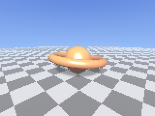
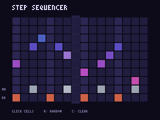
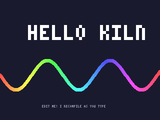

# Kiln

**A tiny statically typed language that compiles straight to WebAssembly, with a live-coding pixel playground.**

Kiln's compiler is about 3,300 lines of dependency-free JavaScript. It lexes, parses, type-checks and
then writes the WebAssembly binary *byte by byte*: no LLVM, no Binaryen, no `wat2wasm`. It is fast
enough to recompile on every keystroke, so the playground feels like a fantasy console: type
code on the left and watch it run at native speed on a 320×240 screen on the right, with sound.


<table>
<tr>
<td><br><sub><b>landscape</b>: voxel-space terrain flyover</sub></td>
<td><br><sub><b>raymarch</b>: signed distance fields, soft shadows</sub></td>
</tr>
<tr>
<td><br><sub><b>mandelbrot</b>: endless smooth-colored zoom</sub></td>
<td><br><sub><b>fire</b>: the word KILN, burning</sub></td>
</tr>
<tr>
<td><br><sub><b>plasma</b>: the demoscene classic</sub></td>
<td><br><sub><b>particles</b>: 4,000 particles with additive light</sub></td>
</tr>
<tr>
<td><br><sub><b>life</b>: Conway's Life with glowing trails; draw with the mouse</sub></td>
<td><br><sub><b>dodge</b>: a small arcade game with sound effects</sub></td>
</tr>
<tr>
<td><br><sub><b>sequencer</b>: click to compose; a 16-step drum and melody loop</sub></td>
<td><br><sub><b>hello</b>: a guided first program</sub></td>
</tr>
</table>

Every image above was rendered headlessly by the Kiln CLI (`kiln render`), from the programs in [`examples/`](examples).

## Try it

```sh
npm run serve          # builds the playground and serves it at http://localhost:8000
```

Or run `npm run build` and open `dist/index.html` directly. It's a single self-contained file that works
offline, from `file://`. There's nothing to install: the project has zero dependencies.

The command-line tool runs on Node 20+:

```sh
node bin/kiln.js run examples/hello.kiln          # compile and run main()
node bin/kiln.js wat examples/plasma.kiln         # print the generated WebAssembly text
node bin/kiln.js build examples/fire.kiln         # write fire.wasm
node bin/kiln.js render examples/raymarch.kiln -t 3 -o shot.png   # headless screenshot
node bin/kiln.js audio examples/sequencer.kiln -t 8 -o loop.wav    # headless audio recording
```

## A taste

```rust
// Every pixel adds up a few sine waves; the sum picks a color.
fn frame(t: float) {
  for y in 0..HEIGHT {
    for x in 0..WIDTH {
      let u = x as float / 38.0;
      let v = y as float / 38.0;
      let s = sin(u + t) + sin((v + t) * 0.7) + sin((u + v + t * 0.6) * 0.8);
      pixel(x, y, hsv(s * 0.15 + t * 0.05, 0.8, 1.0));
    }
  }
}
```

`main()` runs once; `frame(t)` runs every animation frame. Programs draw into a 320×240 framebuffer
(colors are `0xRRGGBB`), read the mouse and keyboard, and `print()` to a console.

## The language

```rust
const N = 64;                     // compile-time constant (folded away)
var grid: [int; N * N];           // arrays are global, zeroed, bounds-checked
let palette = [0x000000, 0xff8800, 0xffffff];
var score = 0;                    // mutable global

fn clamp01(x: float) -> float {
  return x < 0.0 ? 0.0 : (x > 1.0 ? 1.0 : x);
}

fn main() {
  let name = "kiln";              // immutable, type inferred (str)
  var total = 0;                  // mutable
  for i in 0..len(name) { total += name[i]; }    // strings index to bytes
  for i in 1..=10 { if i % 2 == 0 { continue; } total += i; }
  while total > 100 { total /= 2; }
  print("total:", total, "half:", total as float / 2.0);
}
```

- **Types:** `int` (i32), `float` (f64), `bool`, `str`, structs, and fixed-size global arrays of any of those except `str`.
- **No silent conversions.** `int + float` is an error that suggests `as float`. One concession for
  comfort: integer *literals* (and untyped integer constants) adapt to float context, so `x * 2` works when `x` is a float.
- **`let` is immutable, `var` is mutable.** Assigning to a `let` is a compile error with a fix-it hint.
- **Control flow:** `if`/`else if`/`else`, `while`, `for i in a..b` and `a..=b`, `break`, `continue`, `return`, and `cond ? a : b`.
- **Operators:** the usual arithmetic, comparison and logical operators (short-circuiting), plus `& | ^ ~ << >> >>>` and
  compound assignment. Bitwise operators bind tighter than comparisons, so `x & 1 == 1` means what it looks like.
- **Built-ins** compile to single wasm instructions where possible (`sqrt`, `floor`, `min`, `abs`, `select`, ...);
  transcendental functions (`sin`, `pow`, ...) are imported from the host.
- **The standard prelude is written in Kiln** ([`src/prelude.js`](src/prelude.js)): `pixel`, `rect`, `circle`, Bresenham
  `line`, `hsv`, `blend`, a 3×5 bitmap font for `text` and `number`, integer `hash`, value `noise` and `fbm`.
  It's compiled together with your program, and whatever you don't use is stripped.

### Structs

```rust
struct Vec2 { x: float, y: float }
struct Ball { pos: Vec2, vel: Vec2, color: int }

const GRAVITY = Vec2(0.0, 260.0);   // constructed like a call, folded at compile time
var balls: [Ball; 100];             // arrays of structs

fn length(v: Vec2) -> float { return sqrt(v.x * v.x + v.y * v.y); }

fn step(dt: float) {
  for i in 0..len(balls) {
    var b = balls[i];               // structs are values: this is a copy
    b.vel += GRAVITY * dt;          // component-wise math
    b.pos += b.vel * dt;
    if b.pos.y > 239.0 { b.vel.y *= -0.8; }
    balls[i] = b;                   // write it back
  }
}
```

- Structs are **values**, like numbers: assigning or passing one copies it. There are no pointers and no heap.
- Structs whose fields are all floats (or all ints) get **component-wise** `+ - * / %`, with each other or with a
  single number on either side, GLSL-style. Any struct supports `==` and `!=`.
- `print(v)` shows a struct the way you'd construct it: `Ball(Vec2(1.0, 2.0), Vec2(0.0, 0.0), 16746496)`.

Under the hood, a struct is **flattened into its scalar fields**. A `Vec2` local is two wasm locals, a `Vec2` parameter
is two wasm parameters, and a function returning one uses wasm's multi-value returns. So vector math costs exactly what
the scalar version would. This function:

```rust
export fn add(a: Vec2, b: Vec2) -> Vec2 { return a + b; }
```

compiles to two additions, with no memory traffic and no temporaries:

```wasm
(func $add (export "add") (param $a.x f64) (param $a.y f64) (param $b.x f64) (param $b.y f64) (result f64 f64)
  local.get $a.x
  local.get $b.x
  f64.add
  local.get $a.y
  local.get $b.y
  f64.add
  return
)
```

Arrays of structs are laid out in linear memory with natural alignment, and `balls[i].vel.y` compiles to one bounds
check plus a single `f64.load` at a constant offset.

### Sound

```rust
beep(440.0, 0.2);                               // frequency in Hz, seconds
sound(WAVE_SQUARE, 988.0, 1976.0, 0.1, 0.3);    // wave, from Hz, to Hz, seconds, volume
sound(WAVE_NOISE, 2500.0, 70.0, 0.9, 1.0);      // noise sweeping down: an explosion
sound_at(t + 0.5, WAVE_TRIANGLE, note(60), note(60), 0.3, 0.5);   // middle C, half a second from now
```

Five waves (square, triangle, saw, sine and filtered noise), each with an exponential pitch slide and a short
attack-hold-fade envelope. That's enough for chiptune music and arcade effects. `note(n)` converts MIDI note
numbers to Hz.

Programs run in a Web Worker, which can't use Web Audio, so a sound call just records an *event* on the program's
clock (the same clock as `t` and `now()`). Events ride along with each frame's pixels, and the page schedules them on
the audio clock with a small fixed latency. Because events carry exact times, `sound_at` can schedule notes between
frames: the [sequencer](examples/sequencer.kiln) uses the classic look-ahead pattern, so its beat stays sample-steady
even when frames jitter.

Every event follows one small spec ([`src/sound.js`](src/sound.js)), implemented twice: with Web Audio nodes in the
playground, and by a software synth ([`src/synth.js`](src/synth.js)) that `kiln audio` uses to record WAV files. The
software synth is also what the tests listen to: they measure pitch, slides, timing and the envelope from the samples.

### Friendly errors

The checker reports every type error it finds, with a span, and offers suggestions where it can:

```
error: can't apply '+' to int and float
 --> demo.kiln:4:13
  |
4 |   let c = a + b;
  |             ^
  = help: Kiln never converts silently; write 'x as float' or 'x as int'
```

It also suggests close matches for misspelled names (`unknown function 'pixl'` gets "did you mean 'pixel'?"), catches
functions that don't return on every path, and rejects assignments to immutable values, among other things. Runtime
traps come back with line numbers too: `index 4 is out of bounds for 'grid', which has 4 elements (line 12)`.

## How it works

```
source ──lex──▶ tokens ──parse──▶ AST ──check──▶ typed AST ──codegen──▶ .wasm bytes + WAT listing
                                      (prelude AST joins here)    │
                                                                  └─ reachable functions only
```

| File | What it does |
|---|---|
| [`src/lexer.js`](src/lexer.js) | Tokens with spans; hex/binary/underscored literals, escapes, block comments |
| [`src/parser.js`](src/parser.js) | Recursive descent for statements, precedence climbing for expressions |
| [`src/checker.js`](src/checker.js) | Name resolution, type inference and checking, constant folding, definite-return analysis, call graph |
| [`src/types.js`](src/types.js) | Struct flattening and memory layout |
| [`src/codegen.js`](src/codegen.js) | Emits wasm instructions and a matching WAT listing side by side; strips dead code |
| [`src/wasm.js`](src/wasm.js) | LEB128, section encoding, the opcode table |
| [`src/prelude.js`](src/prelude.js) | The standard library, in Kiln |
| [`src/runtime.js`](src/runtime.js) | Host imports, readable trap messages, framebuffer to RGBA, sound events |
| [`src/sound.js`](src/sound.js), [`src/synth.js`](src/synth.js) | The sound spec, and an offline synth with a WAV encoder |
| [`web/`](web) | The playground: editor, worker runner with a watchdog, inspector tabs |
| [`scripts/build.js`](scripts/build.js) | A 40-line bundler, then inlines everything into one HTML file |

A few details I enjoyed:

- **Two outputs, one pass.** Every `emit()` writes bytes *and* a line of WAT, so the WebAssembly tab in the playground
  is exactly what runs, interleaved with the source lines that produced it.
- **Dead code elimination falls out of the checker.** Each function records what it calls and which globals, arrays
  and imports it touches. Codegen walks that graph from `main`/`frame`/exports, so the plasma example ships 5 functions
  and strips the other 22, and imports only the 3 host functions it uses (`sin`, `cos`, and the trap hook).
- **Fields are places, not values.** Codegen resolves `a.b.c` and `arr[i].pos.x` to a *place* (a run of locals, a run of
  globals, or a base address plus a constant offset) and loads or stores only the leaves it needs.
- **Arrays use the memarg offset.** `grid[i]` compiles to `i32.load offset=<grid's address>` with the scaled index on the
  stack, after a single unsigned compare for the bounds check (which also catches negative indices).
- **Traps know where they came from.** Bounds and division checks call an imported `__trap(site, value)`; the site
  indexes a table the compiler emits, so the runtime can say *which* array, *what* index and *which line*.
- **The playground can't be frozen.** Programs run in a Web Worker built from a blob. The main thread only requests the
  next frame when the previous one is done, and a watchdog terminates a worker that stops answering.
- **Live edits keep the clock.** Recompiling restarts the program but not `t`, so you can tweak a shader's constants and
  watch it change smoothly.

Here's `fib` as the compiler emits it (from the playground's WebAssembly tab):

```wasm
(func $fib (param $n i32) (result i32)
  ;; 3: if n < 2 { return n; }
  local.get $n
  i32.const 2
  i32.lt_s
  if
    local.get $n
    return
  end
  ;; 4: return fib(n - 1) + fib(n - 2);
  local.get $n
  i32.const 1
  i32.sub
  call $fib
  local.get $n
  i32.const 2
  i32.sub
  call $fib
  i32.add
  return
)
```

## Development

```sh
npm test           # 61 tests: language semantics, structs, sound, error messages, runtime traps, every example, the build
npm run build      # dist/index.html
npm run serve      # build + serve on :8000
```

CI runs the tests and the build on every push. The `Pages` workflow publishes the playground to GitHub Pages
from the default branch (enable it under *Settings → Pages → Source: GitHub Actions*).

## Limits and ideas

Kiln is deliberately small. There are no closures, methods, generics, heap allocation, string concatenation or
modules; arrays are global and can't be passed around. Natural next steps would be a guided tour in the playground,
`f32`/SIMD for faster shading, a pass that reuses locals, and source maps from wasm offsets back to lines.

## License

MIT
